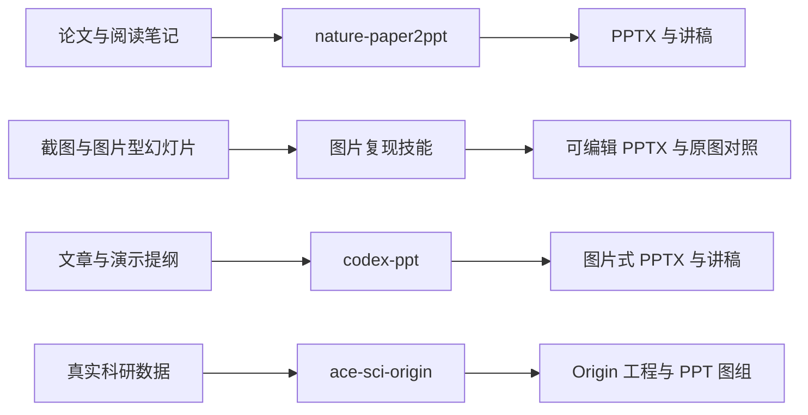

<p align="center">
  
</p>

# Research PPT Skills · 科研演示技能集

**把科研材料变成讲得清楚、便于修改的演示文稿。**

面向论文组会、文献汇报、学术答辩和科研图组的个人技能合集，由 [Medal-Pan](https://github.com/Medal-Pan) 整理维护。包含自编轻量技能与保留原作者署名的第三方技能本地版本。

[技能选择](#选哪个技能) · [安装](#安装) · [使用示例](#使用示例) · [边界](#使用边界) · [来源与许可](THIRD_PARTY_NOTICES.md) · [English](README_EN.md)

## 选哪个技能

| 你的材料与目标 | 技能 | 页面可编辑程度 | 主要要求 |
| --- | --- | --- | --- |
| 论文 PDF / 阅读笔记 → 中文组会、文献汇报 | [nature-paper2ppt](skills/nature-paper2ppt/SKILL.md) | 文字可编辑，论文原图保留为图片 | Python，PDF / PPTX 处理依赖 |
| 幻灯片截图 → 保留质感，主要文字可编辑 | [image-to-editable-ppt](skills/image-to-editable-ppt/SKILL.md) | 主要文字与简单元素可编辑，复杂视觉保留图片 | 能查看图片并生成 PPTX 的 Agent |
| 图片型 PPT / 扫描页面 → 更细的对象重建 | [nature-image2ppt](skills/nature-image2ppt/SKILL.md) | 按区域重建对象，复杂局部可保留图片 | Python 3.10+，渲染器，部分任务需公式工具 |
| 论文 / 提纲 → 统一风格的图片式演示稿 | [codex-ppt](skills/codex-ppt/SKILL.md) | 页面主体为图片，备注可编辑 | 生图能力或兼容 API；子 Agent 要求见技能 |
| 数据表 → Origin 可编辑图组与 PPT | [ace-sci-origin](skills/ace-sci-origin/SKILL.md) | Origin 工程及 PPT 中的 OLE 图对象 | Windows、Origin/OriginPro、PowerPoint |

仅需快速复现图片中的主要文字，优先使用 `image-to-editable-ppt`；需要精细结构、箭头、对象检查和渲染证据时，再选 `nature-image2ppt`。

## 工作方式



技能负责让 Agent 按可复用流程工作；运行所需的 Python 包、Office 软件、生图服务等应按所选技能另行准备。

## 安装

先下载本仓库。安装脚本只复制所选技能，不会安装 Python 依赖，也不会覆盖已有同名目录。

```bash
git clone https://github.com/Medal-Pan/research-ppt-skills.git
cd research-ppt-skills

# 先查看安装计划
python scripts/install_skills.py --skill image-to-editable-ppt --dry-run

# 安装最轻量的图片复现技能
python scripts/install_skills.py --skill image-to-editable-ppt
```

默认安装到 `$CODEX_HOME/skills`；没有设置该变量时，使用用户目录下的 `.codex/skills`。其他支持 `SKILL.md` 的宿主可通过 `--dest` 指定其技能目录；本仓库未对所有宿主进行兼容性实测。

```bash
# 安装论文汇报与图片重建两个技能
python scripts/install_skills.py --skill nature-paper2ppt --skill nature-image2ppt

# 指定自定义位置
python scripts/install_skills.py --skill image-to-editable-ppt --dest ./my-skills
```

也可以直接复制 `skills/` 下所需的完整文件夹。`nature-paper2ppt` 所需的共享术语规则已经包含在本仓库版本中。依赖安装与渲染说明见 [安装指南](docs/INSTALL.md)。

## 使用示例

在支持技能的 Agent 中附上材料，并明确所用技能。

**论文汇报**

```text
使用 $nature-paper2ppt，将附件论文做成面向本组研究生的 12 页中文组会 PPT。
报告时间 15 分钟，突出研究问题、关键证据、局限，保留关键原图并附演讲备注。
```

**图片复现**

```text
使用 $image-to-editable-ppt，把附件截图复现为 16:9 可编辑 PPTX。
复杂视觉保留原图素材，主要文字和简单图形用原生对象重建，提供预览与原图对照。
```

**更细的对象重建**

```text
使用 $nature-image2ppt，还原附件中的 3 页图片型 PPT。
尽量重建文字、节点和连接线，交付可编辑 PPTX、逐页预览和仍为图片的区域说明。
```

**图片式演示稿**

```text
使用 $codex-ppt，基于附件研究提纲制作一套统一风格的学术分享 PPT。
采用科研答辩风，先确定大纲与样张，再生成整套，并将演讲稿写入备注。
```

**科研图组**

```text
使用 $ace-sci-origin，将附件数据制作成论文图组。
先建立 Python 参考图，再生成可编辑 Origin 工程与带 OLE 对象的 PPT，附预览和检查结果。
```

更多材料准备与交付约定见 [使用场景](docs/USE_CASES.md)。

## 使用边界

- `codex-ppt` 的页面主体是图片。需要修改文字或形状时，可继续使用图片复现技能。
- 图片复现采取混合重建。照片、复杂插图和部分小字可能仍是图片，不承诺全页所有元素均可编辑。
- 不可从截图可靠恢复的数据应保留为图像，或明确标为视觉近似；不能把近似值当作真实实验数据。
- 论文原图、字体、商标和用户材料的权利独立于技能源码许可证。
- 在线生图或 OCR 可能将必要材料发送到相应服务；请按材料要求选择离线或获准的服务。
- 本次发布检查覆盖文件结构、依赖路径、源码语法和打包内容；未宣称已在所有操作系统或第三方服务上跑通完整 PPT 制作流程。

## 目录

```text
research-ppt-skills/
├── skills/                  # 五个可单独安装的完整技能目录
├── scripts/                 # 选择性安装与发布检查
├── docs/                    # 安装、场景与验证记录
├── assets/banner.svg        # 仓库封面
├── skills.json              # 技能目录及来源元数据
├── THIRD_PARTY_NOTICES.md    # 署名、原始仓库与分发范围
└── LICENSE                  # 本仓库新增内容的许可证
```

## 配套项目

本机使用的其他配套工具可从原仓库获取：

- [PPT Master](https://github.com/hugohe3/ppt-master)：完整的原生 PPTX 创作、编辑与模板工作流。
- [Vivid Illustration Skill](https://github.com/yjz211/vivid-illustration-skill)：科研绘图与架构图工作流；其许可限制再分发，本仓库仅提供链接。
- 宿主自带的 `presentations` 技能由相应宿主提供，本合集不复制其运行库。

## 来源与许可

`nature-paper2ppt` 来源于 [Paul-Jeo/nature-skills](https://github.com/Paul-Jeo/nature-skills)，`nature-image2ppt` 保留 [Image2PPT](https://github.com/Paul-Jeo/Image2PPT) 的实现与署名，`codex-ppt` 来源于 [ningzimu/codex-ppt-skill](https://github.com/ningzimu/codex-ppt-skill)，`ace-sci-origin` 保留 [hzsci/ace-sci-origin](https://github.com/hzsci/ace-sci-origin) 的作者信息。具体许可证以各技能目录为准。

本仓库新增的图片复现轻量技能、安装脚本、检查脚本与仓库文档采用 [MIT License](LICENSE)。来源、改动与 README 结构参考见 [第三方说明](THIRD_PARTY_NOTICES.md)。

欢迎通过 [Issues](https://github.com/Medal-Pan/research-ppt-skills/issues) 提交可复现的问题。请附技能名、环境、最小输入说明和错误信息；不要上传未获授权的论文、实验数据或凭据。贡献方式见 [CONTRIBUTING.md](CONTRIBUTING.md)。
